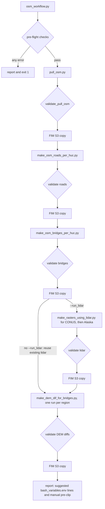

## What changed

No data script changed. The workflows run the PR #1949 scripts (`pull_osm.py`, `make_osm_roads_per_huc.py`,
`make_osm_bridges_per_huc.py`, `make_rasters_using_lidar.py`, `make_dem_dif_for_bridges.py`) with their existing
command lines. `src/bash_variables.env` and `workflows/deploy/` are also unchanged.

### New: `workflows/shared/` (reusable by every workflow; standard library only)

| File | Purpose |
|---|---|
| `workflow_runner.py` | `Step`, `StepResult` and `WorkflowRunner`. Runs steps in order behind their gates and saves `<name>_state.json` after every step. Supports `--resume` and `--from_step`, lists the steps, and writes `<name>_report.md`. Also has `read_env_file`, a read-only reader for `KEY=value` files such as `bash_variables.env`. |
| `regions.py` | The four regions: `conus`, `alaska`, `guam` and `american_samoa`. For each region: the HUC rule, the CRS, its `bash_variables.env` DEM and DEM-diff variables, and the DEM folders to pass to `-d`. |
| `s3_copy.py` | The FIM S3 copy step. It builds the file list, previews by default, uploads behind the overwrite guard, and then confirms every file arrived. |

### New: `workflows/validators/` (one validator per data script)

| File | Validates the output of |
|---|---|
| `validator_base.py` | Shared pieces: `CheckResult`, `ValidationResult` with its JSON report, the newest-log lookup, log markers, the HUC coverage rule, GeoParquet schema/row/CRS checks (pyarrow loaded only when needed), baseline comparisons and `run_validator_cli` |
| `validate_pull_osm.py` | `data/osm/pull_osm.py` |
| `validate_make_osm_roads_per_huc.py` | `data/roads/make_osm_roads_per_huc.py` |
| `validate_make_osm_bridges_per_huc.py` | `data/bridges/make_osm_bridges_per_huc.py` |
| `validate_make_rasters_using_lidar.py` | `data/bridges/make_rasters_using_lidar.py` (one run per region) |
| `validate_make_dem_dif_for_bridges.py` | `data/bridges/make_dem_dif_for_bridges.py` (one run per region) |

Every validator can also be run on its own and exits 0 (pass) or 1 (fail), so it can check a manual run too.

### New: `workflows/inputs/` (the OSM workflow)

| File | Purpose |
|---|---|
| `osm_common.py` | `OsmContext` holds the version, folders, options and defaults. Also holds the shared command-line options, the pull step and S3 copy step builders, the pre-flight checks, the final report, and `run_workflow_cli`, the `main()` body all three commands share. |
| `osm_roads_workflow.py` | `build_roads_steps(ctx)`, plus a stand-alone roads command |
| `osm_bridges_workflow.py` | `build_bridges_steps(ctx)`: bridges per HUC, then lidar for CONUS and Alaska (only with `--run_lidar`), then DEM diffs per region. Also a stand-alone bridges command. |
| `osm_workflow.py` | The parent command: pull, then roads, then bridges |

### New: `workflows/tests/`

Unit tests use `unittest` and synthetic data:

- `test_workflow_runner.py`, `test_regions.py`, `test_validator_base.py`: the runner, regions and validator helpers
- `test_osm_validators.py`, `test_bridges_validators.py`: all five validators, with tiny GeoParquet and GeoTIFF fixtures
  from `helpers.py`
- `test_osm_step_building.py`, `test_osm_workflow.py`: step commands, pre-flight checks and the final report
- `test_s3_copy.py`: preview, upload, the overwrite guard and incomplete uploads, using a fake S3 layer
- `test_osm_log_patterns.py`: every log line, file name and option that a validator or step builder relies on still
  exists in the data scripts
- `test_cli.py`: runs the real command lines (`--help`, `--list_steps`, a failed pre-flight, a stand-alone validator)

### Changed

- `config/workflows_params.template.env`: new "Inputs workflows" section.
  - `FIM_S3_ROOT_INPUTS_PATH` defaults to `notset`, with commented test and production values.
  - `OSM_DEM_DIFF_EXTRA_DEM_DIRS_ALASKA` defaults to the North Alaska IfSAR DEM folder.
- `docs/CHANGELOG.md`: new entry.

### Architecture



Any failed gate (non-zero exit or `False` validator) goes straight to the report and exit code 1.
`--skip_roads` and `--skip_bridges` drop those parts of the chain.

### Steps and their names

Use these names with `--from_step`. `--list_steps` prints them, with the full command of each script step.

| Step | What it runs |
|---|---|
| `osm.pull` | `pull_osm.py -o <geofabric dir> [-s <states>]`, gated by `validate_pull_osm` |
| `osm.roads_per_huc` | `make_osm_roads_per_huc.py -r -p -o -j [-lh]`, gated by `validate_make_osm_roads_per_huc` |
| `osm.bridges_per_huc` | `make_osm_bridges_per_huc.py -b -p -o -j [-lh]`, gated by `validate_make_osm_bridges_per_huc` |
| `bridges.lidar` | Placeholder, shown as skipped when `--run_lidar` is not set |
| `bridges.lidar.conus`, `bridges.lidar.alaska` | With `--run_lidar`: `make_rasters_using_lidar.py -i -o -lh -jl -jr`. The `-lh` list is that region's HUCs with a bridges file, found when the step starts. Gated by `validate_make_rasters_using_lidar`. |
| `bridges.dem_diff.<region>` | `make_dem_dif_for_bridges.py -d <DEM folders> -l -i -o -j` for `conus`, `alaska`, `guam`, `american_samoa`, gated by `validate_make_dem_dif_for_bridges` |
| `<step>.s3_copy` | The FIM S3 copy (preview or upload) after `osm.pull`, `osm.roads_per_huc`, `osm.bridges_per_huc`, `bridges.lidar` (when run) and each `bridges.dem_diff.<region>` |

### Output and log layout

Outputs use the same versioned layout as `bash_variables.env`:

```text
<output_root>   (-o, default ${inputsDir}/osm)               bash_variables.env line to update by hand
├── geofabric_states/<version>/
│   ├── states_parquet/roads/<state>_roads.parquet          osm_geofabric_states_roads_dir
│   ├── states_parquet/bridges/<state>_bridges.parquet      osm_geofabric_states_bridges_dir
│   └── pull_osm_<timestamp>.log
├── roads/<version>/roads_<HUC8>.parquet                    osm_roads_per_huc_dir
└── bridges/
    ├── bridge_lines/<version>/bridges_<HUC8>.parquet       (input to the lidar and DEM-diff scripts)
    ├── lidar_data/<version>/                               only with --run_lidar
    │   ├── lidar_processing/<HUC8>/lidar_osm_rasters/
    │   └── modified_osm_bridges/                           osm_bridges_modified_dir
    └── DEM_Diffs/<version>/<region>/bridge_elev_diff.vrt   input_bridge_elev_diff, _alaska, _guam, _americansamoa

<log_dir>   (--log_dir, default ${outputsDir}/workflow_logs/osm_<version>)
├── osm_workflow_<timestamp>.log          (plus -errors.log and -warnings.log)
├── osm_<version>_state.json              step results, used by --resume and --from_step
├── osm_<version>_report.md               final report
├── validate_<script>_<target>.json       one JSON report per validator run
└── s3_copy_<step>.s3_copy.json           full file list of each FIM S3 copy (preview or upload)
```

Each data script keeps writing its own log into its output folder, as before.

The roads and bridges commands use `osm_roads_*` and `osm_bridges_*` for their state, report and log names, in the
same log folder.

---

## How to run

### Prerequisites

- Run inside the FIM Docker container:
  - `inputsDir` and `outputsDir` are set
  - `osmium-tool` is installed (`Dockerfile.dev`)
- The pre-clip folder (`pre_clip_huc_dir`, or `-p`) has a `wbd.gpkg` in each HUC folder.
- Without `--run_lidar`, the existing lidar folder must exist. By default that is the folder above
  `osm_bridges_modified_dir`, which must contain `lidar_processing/`.
- The DEM folders for the requested DEM-diff regions must exist:
  - the folders of `input_DEM*` in `bash_variables.env`
  - for Alaska, also `OSM_DEM_DIFF_EXTRA_DEM_DIRS_ALASKA`
- Uploads only:
  - a working copy of `config/workflows_params.template.env`
  - the AWS credentials file with `FIM_AWS_ACCESS_KEY_ID`, `FIM_AWS_SECRET_ACCESS_KEY` and `FIM_AWS_REGION_NAME`

Pre-flight checks confirm all of this before any long step starts.

### Copy-paste examples

All examples use the parent command, `osm_workflow.py`, unless noted otherwise. Use a new `-v` for every new data
version.

```bash
# 1. See every planned step and command without running anything
python /workflows/inputs/osm_workflow.py -v 20261108 --list_steps

# 2. Full run: all states, all pre-clip HUCs, DEM diffs for all four regions, reusing the current lidar
python /workflows/inputs/osm_workflow.py -v 20261108

# 3. Full run with fresh bridge lidar for CONUS and Alaska (adds about 48 hours)
python /workflows/inputs/osm_workflow.py -v 20261108 --run_lidar

# 4. Dev smoke run: one state, one HUC, CONUS DEM diff only, everything under /outputs
python /workflows/inputs/osm_workflow.py -v 20261108 \
    -s 'delaware' -lh '02040205' --dem_diff_regions conus \
    -o /outputs/dev_osm/osm --log_dir /outputs/dev_osm/logs
#    then read /outputs/dev_osm/logs/osm_20261108_report.md

# 5. Continue after a failure (same options as the first run): skip the steps that already passed
python /workflows/inputs/osm_workflow.py -v 20261108 --resume

#    or restart at a named step (earlier steps are not rerun)
python /workflows/inputs/osm_workflow.py -v 20261108 --from_step bridges.dem_diff.alaska

# 6. Upload the validated outputs to FIM S3
cp /config/workflows_params.template.env /data/config/workflow_params.env
#    edit FIM_S3_ROOT_INPUTS_PATH, and FIM_S3_BUCKET_NAME unless it is in the AWS credentials file
python /workflows/inputs/osm_workflow.py -v 20261108 --upload_to_fim_s3 \
    -wp /data/config/workflow_params.env -a /data/config/aws_credentials.env

# 7. Roads only
python /workflows/inputs/osm_workflow.py -v 20261108 --skip_bridges    # pull + roads
python /workflows/inputs/osm_roads_workflow.py -v 20261108             # roads from the current state parquets

# 8. Bridges only (bridges per HUC, optional lidar, DEM diffs) from the current state parquets
python /workflows/inputs/osm_bridges_workflow.py -v 20261108 --run_lidar
python /workflows/inputs/osm_bridges_workflow.py -v 20261108 --dem_diff_regions alaska guam
```

Notes:

- Use the same `-v`, `-o`, `-s`, `-lh`, `--run_lidar` and other options with `--resume` and `--from_step` as in the
  first run. The state file is matched by step name.
- With `--resume`, a step that failed reruns from its start. The long scripts already skip finished work:
  - `pull_osm.py` skips states whose roads and bridges parquets both exist
  - `make_rasters_using_lidar.py` skips HUCs with a modified bridges file
  - `make_dem_dif_for_bridges.py` skips existing diff tifs
- The stand-alone roads and bridges commands default to the state parquets currently set in
  `bash_variables.env`. To use other parquets, pass `-r` (roads) or `-b` (bridges).
- `-s` takes Geofabrik slugs such as `'delaware new-york american-oceania'`.
  - Validators then expect only those states.
  - HUCs that none of the selected states overlap are dropped from the coverage count, with a warning.
- `-lh` limits the per-HUC scripts, and their validators, to those HUCs. Baseline file-count checks are skipped when
  `-s` or `-lh` is given.

### Stand-alone validators (check a manual run)

Each validator prints one line per check, writes its JSON report to `--report_dir` and exits 0 (pass) or 1 (fail).

```bash
python /workflows/validators/validate_pull_osm.py \
    -o /data/inputs/osm/geofabric_states/20261108 [-s 'delaware'] \
    [--baseline_roads_dir <dir>] [--baseline_bridges_dir <dir>] --report_dir /outputs/temp

python /workflows/validators/validate_make_osm_roads_per_huc.py \
    -o /data/inputs/osm/roads/20261108 -p /data/inputs/pre_clip_huc8/20261006 \
    [-lh '<HUC8s>'] [-s '<states>'] [--baseline_dir /data/inputs/osm/roads/20261006] --report_dir /outputs/temp

python /workflows/validators/validate_make_osm_bridges_per_huc.py \
    -o /data/inputs/osm/bridges/bridge_lines/20261108 -p /data/inputs/pre_clip_huc8/20261006 \
    [-lh '<HUC8s>'] [-s '<states>'] [--baseline_dir <old bridge_lines folder>] --report_dir /outputs/temp

python /workflows/validators/validate_make_rasters_using_lidar.py \
    -o /data/inputs/osm/bridges/lidar_data/20261108 -lh '<HUC8s given to the script>' --label alaska \
    --report_dir /outputs/temp

python /workflows/validators/validate_make_dem_dif_for_bridges.py \
    -o /data/inputs/osm/bridges/DEM_Diffs/20261108/conus --region conus --report_dir /outputs/temp
```

### Tests

```bash
# On a host with Python 3.10+ (standard library only; the GeoParquet and GeoTIFF tests skip themselves)
py -m unittest discover -s workflows/tests -t .        # Windows
python3 -m unittest discover -s workflows/tests -t .   # Linux / macOS

# Inside the FIM container (everything runs, including the pyarrow and rasterio fixtures)
python3 -m unittest discover -s /workflows/tests -t /{root}
```

### Options

`osm_workflow.py` takes all of these options. The roads and bridges commands take the same run-control and FIM S3
options, plus their own (shown in their `--help`).

| Option | Default | Meaning |
|---|---|---|
| `-v`, `--version` | required | Version folder name for every output, e.g. `20261108` |
| `-o`, `--output_root` | `${inputsDir}/osm` | OSM output root; point it elsewhere for dev tests |
| `-p`, `--preclip_dir` | `pre_clip_huc_dir` | Pre-clip folder used by the per-HUC scripts |
| `-s`, `--states` | all states | Geofabrik state slugs for `pull_osm.py` |
| `-lh`, `--lst_hucs` | all pre-clip HUCs | HUC8 subset for the per-HUC scripts |
| `--skip_roads`, `--skip_bridges` | off | Leave out the roads or bridges sub-workflow |
| `-j`, `--number_jobs` | 4 | `-j` for the roads and bridges per-HUC scripts |
| `--run_lidar` | off | Run `make_rasters_using_lidar.py` for CONUS and Alaska into `bridges/lidar_data/<version>/` |
| `--existing_lidar_dir` | folder above `osm_bridges_modified_dir` | Lidar root that DEM diffs reuse without `--run_lidar` |
| `--dem_diff_regions` | `conus alaska guam american_samoa` | Regions for the DEM diffs |
| `-jl`, `-jr` | 15, 10 | `-jl` and `-jr` for the lidar script |
| `-jd`, `--dem_jobs` | 10 | `-j` for the DEM-diff script |
| `--resume` | off | Skip the steps that passed in the previous run |
| `--from_step` | none | Restart at this step name; earlier steps are not rerun |
| `--list_steps` | off | Print the planned steps and commands, then exit |
| `--log_dir` | `${outputsDir}/workflow_logs/osm_<version>` | Log, state, report, validator JSON and S3 file lists |
| `--upload_to_fim_s3` | off (preview) | Upload each validated output to FIM S3 |
| `-wp`, `--workflows_params_file` | repo template | Working copy of the params file; its values override the template |
| `-a`, `--aws_creds_file` | `/data/config/aws_credentials.env` | AWS credentials, read only for uploads |
| `--s3_overwrite` | off | Allow uploads into S3 folders that already exist |

### After every run

1. Read `osm_<version>_report.md`. It has these sections:
   - the step table and any pre-flight errors or warnings
   - a summary of every validator, with each failed or warning check
   - the FIM S3 copies: what was previewed or uploaded, with the path of each file list
   - suggested `bash_variables.env` lines, only for outputs that were produced and validated
   - a warning when lidar was not run
   - the manual next steps
2. If something failed, read the validator JSON for that step and the script's own log in its output folder. Fix
   the cause, then rerun with `--resume`.
3. Edit `src/bash_variables.env` by hand with the suggested lines. Pre-clip reads `osm_roads_per_huc_dir` and
   `osm_bridges_modified_dir` from it.
4. When every input workflow you need has finished, run pre-clip by hand. The report prints a command shaped like
   this one. `--osm_bridges` is only listed when new modified bridges were made, which needs `--run_lidar`.

   ```bash
   python /data/wbd/generate_pre_clip_fim_huc8.py -u /data/inputs/huc_lists/full_huc_list.lst \
       -n /data/inputs/pre_clip_huc8/<new_version>/ --copy_from_dir <current pre_clip_huc_dir>/ \
       --osm_roads --osm_bridges
   ```

5. Update `pre_clip_huc_dir` in `bash_variables.env` once the new pre-clip has been checked.

---

## Validation strategy

### Gate order

For every script step:

1. The script's exit code. Non-zero fails the step, and the validator is not called.
2. The validator. `False` fails the step.
3. The FIM S3 copy step. It runs only after the previous gates passed. A preview never fails. A failed upload fails
   its step.

Before the first step, **pre-flight checks** stop the run early when something would make a later, long step fail.

| Pre-flight check | Result |
|---|---|
| An output version folder for a part that will run already exists | error, unless `--resume` or `--from_step` |
| The pre-clip folder is missing or has no HUC8 folders | error (roads or bridges) |
| A HUC given with `-lh` is not in the pre-clip folder | error |
| A pre-clip HUC folder has no `wbd.gpkg` | error with `-lh`; warning for a full run, because the coverage threshold allows a few |
| Without `--run_lidar`, the existing `lidar_processing/` folder is missing | error (bridges) |
| A DEM folder for a requested DEM-diff region is missing | error (bridges) |
| Uploading with `FIM_S3_ROOT_INPUTS_PATH` or `FIM_S3_BUCKET_NAME` still `notset`, or with no AWS credentials file | error |
| Uploading and the bucket can't be reached | error |
| Uploading and the S3 folder of a copy step that will run already exists | error, unless `--s3_overwrite` |

### Errors and warnings

Every check is a `CheckResult` with `passed` and `is_warning`. A validator passes when every check passed or is a
warning. Warnings are reported but never stop the workflow. They are used when a check can't be made, such as a
missing baseline, or when a result is suspicious but legitimate, such as a stale file.

### Two kinds of checks

1. **Hard-coded minimums**: files exist, required columns, CRS per region, minimum rows, HUC coverage and log markers.
2. **Comparison against the current version in `bash_variables.env` (the baseline)**:
   - per-state row counts against `osm_geofabric_states_*_dir`
   - per-HUC file counts against `osm_roads_per_huc_dir`, and against the `bridge_lines` folder of the version in
     `osm_bridges_modified_dir`

   These run on full runs only. A missing baseline is a warning.

All thresholds and log patterns are module constants at the top of each validator. They are first guesses: tune
them after real runs.

### Checks and thresholds

Region CRS: conus EPSG:5070, alaska EPSG:3338 (HUC `19*`), guam EPSG:6637 (`22010000`), american_samoa EPSG:32702
(`22030001`).

| Validator | Fails when | Constants |
|---|---|---|
| `validate_pull_osm` | <ul><li>a requested state has no `<state>_roads.parquet`</li><li>a state has no `<state>_bridges.parquet` and the newest log has no `[bridges] <state>: ... skipping` line (with that line it is a warning)</li><li>required columns are missing</li><li>the CRS is wrong (`alaska` 3338, `american-oceania` 4326, other states 5070)</li><li>a file has too few rows</li><li>a state's row count is outside the ratio band of the same file in the baseline</li><li>the newest `pull_osm_*.log` contains `❌` (the `state(s) failed` line), or no log exists</li></ul> | `MIN_ROAD_ROWS = 100`, `MIN_BRIDGE_ROWS = 1`, `BASELINE_ROW_RATIO = (0.8, 1.5)`, `ROAD_COLUMNS = osmid, highway, geometry`, `BRIDGE_COLUMNS = osmid, bridge_type, geometry` |
| `validate_make_osm_roads_per_huc` | <ul><li>the pre-clip folder or a `-lh` HUC folder is missing</li><li>HUC coverage is below the minimum (see the rule below)</li><li>a `roads_<HUC8>.parquet` is missing required columns or has the wrong CRS for its region</li><li>full runs only: there are fewer files than the share of the baseline count</li><li>the newest `make_osm_roads_*.log` contains `❌`, or no log exists</li></ul>A file for a HUC that the log calls `No roads within HUC` is a stale-file warning (this script does not delete old files). | `MIN_HUC_COVERAGE = 0.98`, `BASELINE_FILE_RATIO = 0.95`, `REQUIRED_COLUMNS = osmid, huc8, osmid_catchid, geometry` |
| `validate_make_osm_bridges_per_huc` | <ul><li>the same checks as roads, using `bridges_<HUC8>.parquet`, `No bridges within HUC` and the newest `make_osm_bridges_*.log`</li><li>any `bridges_*_bad.parquet` exists (left by a failed HUC)</li></ul> | `MIN_HUC_COVERAGE = 0.98`, `BASELINE_FILE_RATIO = 0.95`, `REQUIRED_COLUMNS = osmid, huc8, geometry` |
| `validate_make_rasters_using_lidar` (CONUS run, then Alaska run) | <ul><li>`lidar_processing/` or `modified_osm_bridges/` is missing</li><li>no HUCs were given, and none are found in `lidar_processing/`</li><li>too few HUCs have at least one raster in `lidar_processing/<HUC8>/lidar_osm_rasters/`</li><li>too few HUCs have `huc_<HUC8>_osm_bridges_modified.parquet`</li><li>the summary CSV is missing or unreadable: `all_bridge_elevation_filter_summary.csv` when more than one HUC was given, else that HUC's `bridge_elevation_filter_summary.csv`</li></ul>`❌` or `ERROR` in the newest `make_rasters_using_lidar_*.log` is a warning only. A region without bridge files is skipped, with a warning. | `MIN_LIDAR_HUC_FRACTION = 0.5`, `MIN_MODIFIED_HUC_FRACTION = 0.95` |
| `validate_make_dem_dif_for_bridges` (one per region) | <ul><li>there are no `*_diff.tif` files</li><li>`bridge_elev_diff.vrt` is missing or unreadable, or has the wrong CRS</li><li>a diff tif is unreadable or has the wrong CRS</li><li>every diff value is zero or nodata (allowed for guam and american_samoa)</li><li>the newest `DEM_diff_rasters-*.log` contains `*** An error occurred` or `❌`, or no log exists</li></ul> | `ALLOW_ALL_ZERO_REGIONS = {guam, american_samoa}` |

### HUC coverage rule (roads and bridges)

All log lines come from the script's newest log in its output folder.

- **Expected HUCs** are the `-lh` HUCs when given. Otherwise they are every 8-digit folder in the pre-clip folder.
- A HUC is **covered** when it has an output file. It is also covered when the log says
  `No roads within HUC <HUC8>` (or `No bridges within HUC <HUC8>`). Those HUCs succeed without writing a file.
- A HUC logged as `No state parquets overlap HUC <HUC8>` depends on `-s`:
  - if `-s` limited the states, it is left out of the count, with a warning
  - otherwise it counts as missing
- A HUC logged as `Missing wbd.gpkg for <HUC8>` counts as missing (a broken pre-clip).
- Coverage is covered ÷ (expected − excluded). It must be at least `MIN_HUC_COVERAGE`. If no HUCs are left to
  check, the validator fails.

### Where the results go

- Each validator run writes `validate_<script>_<target>.json` into the log folder, or into `--report_dir` when run on
  its own. The file has every check with `name`, `passed`, `message` and `is_warning`.
- Per-HUC file checks are rolled up into one result per check type. Each lists up to 20 failing HUCs.
- The final report summarizes every validator JSON in the log folder, with each failed or warning check.

### Tuning

Change the constants at the top of the validator, then rerun the step's validator on its own. If it passes, rerun
the workflow with `--resume` or `--from_step <step>`.

If a data script changes a log message, file name or option, `test_osm_log_patterns.py` fails. Update the matching
constant in the same change.

### FIM S3 copy rules

- **Keys.** Each local file maps to `<FIM_S3_ROOT_INPUTS_PATH>/<path relative to the parent of the output root>`.
  With the default output root, that is the path under `${inputsDir}`. For example, with
  `FIM_S3_ROOT_INPUTS_PATH = "/inputs"`, `/data/inputs/osm/roads/20261108/roads_12090301.parquet` becomes
  `/inputs/osm/roads/20261108/roads_12090301.parquet`.
- **Skipped.** `states_pbf/`, `*.pbf` and `*.las` files are never copied.
- **Preview (default).** Logs the count and destination, writes the full list to `s3_copy_<step>.s3_copy.json`, and
  makes no S3 calls.
- **Upload.** Connects like the deploy tools, with the `FIM_AWS_*` credentials, then checks the bucket.
  - It refuses to write into an S3 folder that already exists, unless `--s3_overwrite` is given.
  - It uploads with `s3_shared_functions.upload_by_file_list`, then lists the S3 folder. The step fails if any file
    is missing, because that helper only logs failed uploads.
- **Bucket name.** `FIM_S3_BUCKET_NAME` is read from the params file, or from the AWS credentials file when the params
  file leaves it `notset`.

### Known limits

- The data scripts exit 0 even when some HUCs or states fail. That is why the validators also read log markers.
  - In `make_dem_dif_for_bridges.py`, the check on line 231 never fires, and lines 255-260 swallow every exception.
    The DEM-diff validator catches both cases through the log text and the missing outputs.
- The newest log is picked by modification time. Log names have minute resolution, so two runs started in the same
  minute share one log.
- The CONUS and Alaska lidar runs share one `lidar_data/<version>/` root. `make_rasters_using_lidar.py` rewrites the
  root `all_*_summary.csv` files on each run, so afterwards they describe the last region only. The per-HUC summaries
  stay complete.
- `MIN_LIDAR_HUC_FRACTION` may need a lower value for Alaska, where lidar coverage is sparser.
- An upload that stops halfway leaves a partial S3 folder. Rerun with `--resume --s3_overwrite`.
- The unit tests use synthetic data. The dev smoke run (example 4) is the first end-to-end check in the container.

---

## Next steps for further automation

### Recipe: adding a new input workflow

1. **Validator.** Add `workflows/validators/validate_<script>.py`, using `validator_base`:
   - `run_checks(...) -> ValidationResult`
   - `validate_<script>(..., report_dir=None) -> bool`
   - a `main()` that ends with `run_validator_cli`

   Keep thresholds and log patterns as module constants.
2. **Steps.** Add `build_<x>_steps(ctx) -> list[Step]` in `workflows/inputs/`. Use one `Step` per script run, built
   with `python_command(script, *args)` and a validator function. Follow each validated output with a copy step from
   `build_copy_step(ctx, name, [output_dir])`. Scripts that run once per region get one step per region; see
   `workflows/shared/regions.py`.
3. **Compose.** Add the steps to a parent workflow, or give the workflow its own command line with
   `run_workflow_cli`. Reuse existing builders, for example the DEM-diff steps from `build_bridges_steps`.
4. **Report.** Add the new `bash_variables.env` lines to `suggested_bash_variables`, and the matching pre-clip flag
   to `manual_next_steps`.
5. **Tests.** Cover:
   - commands match the script's `argparse` options
   - good and bad synthetic output for the validator
   - log patterns and options still exist in the script
6. **Docs.** Update this guide, add a CHANGELOG entry, and add any new settings to
   `config/workflows_params.template.env`.

### Backlog

| Next piece | Scripts | Notes |
|---|---|---|
| Pre-clip | `data/wbd/generate_pre_clip_fim_huc8.py` | All regions at once, after several workflows finish. It can read the "produced" list from each workflow's state file. |
| ESIP copy | none | Uses the existing `ESIP_*` template keys, with the same preview and upload guards as the FIM S3 copy |
| DEMs (1831) | `data/usgs/acquire_and_preprocess_3dep_dems.py`, `data/create_vrt_file.py`, `data/usgs/pit_detect_fill.py` | Per region, then DEM diffs by reusing the bridges DEM-diff steps |
| NWPWC bridge lidar | not yet available | Another lidar source for the DEM diffs |
| FEMA buildings | `data/buildings/get_fema_buildings.py`, `data/buildings/make_buildings_parts_per_huc.py` | Per region |
| WRDS | `data/wrds/download_process_wrds.py` | |
| USGS rating curves | `data/usgs/get_usgs_rating_curves.py` | All regions at once, OWP only |
| FEMA NFHL | `data/nfhl/download_fema_nfhl.py` | Per region |
| NHDPlus | `data/nhdplus/preprocess_nhdplus.py` | Guam and American Samoa only |
| Levees | `data/nld/levee_download.py` | All regions at once |
| Slope | `data/slope/sword_slope_create_parquet_qc.py` | Low priority |
| Research | `ahps_bench_polys_to_calib_pts.py`, `preprocess_ahps_nws.py`, `preprocess_ahps_usgs.py`, other rating-curve inputs (Ripple 1D, water-edge calibration points) | Needs investigation |
| Hardening | data scripts and validators | <ul><li>exit non-zero on partial failure, for example `make_dem_dif_for_bridges.py` lines 231 and 255-260</li><li>tune thresholds after real runs</li><li>per-region summary CSVs in `make_rasters_using_lidar.py`</li></ul> |
